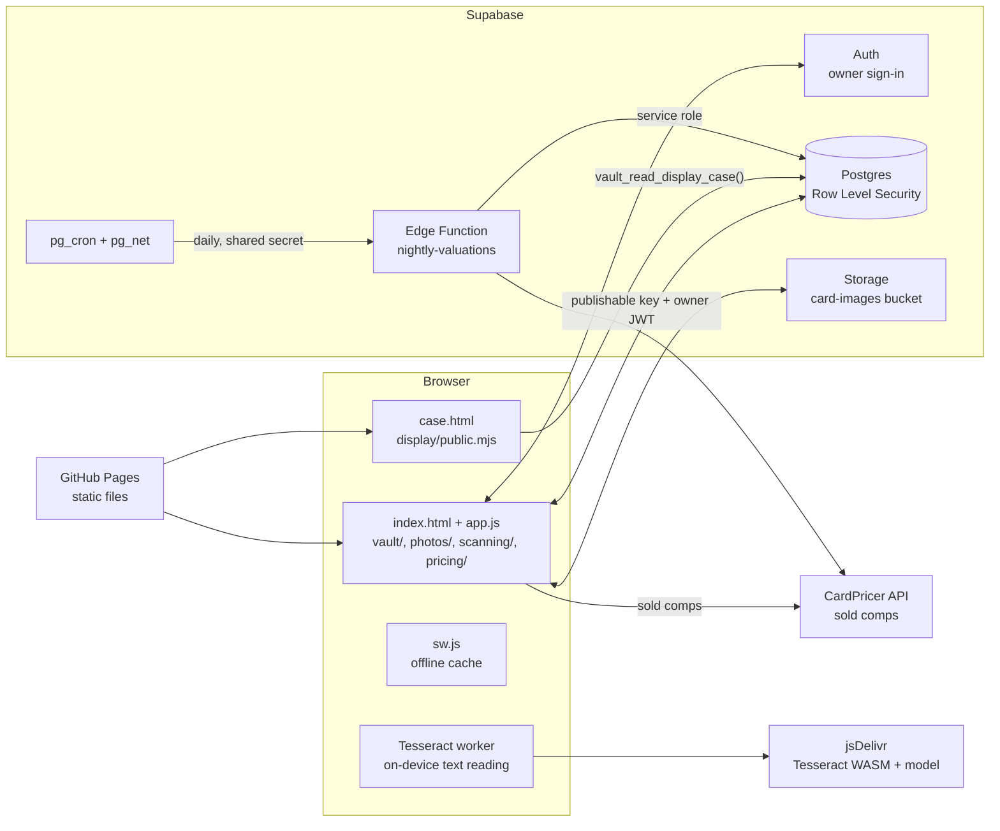

# Architecture

The vault is a static site. GitHub Pages serves the repository's files as they are; the browser talks directly to Supabase. There is no application server.



## Where data lives

| Data                                                                                                    | Where                                             | Who can read                                     | Who can write                                                                    |
| ------------------------------------------------------------------------------------------------------- | ------------------------------------------------- | ------------------------------------------------ | -------------------------------------------------------------------------------- |
| Cards (`public.cards`)                                                                                  | Postgres                                          | Everyone                                         | The card's owner                                                                 |
| Card photos and thumbnails                                                                              | Storage bucket `card-images`, under `<owner id>/` | Everyone (public bucket)                         | The owner, in their own folder only                                              |
| Purchase costs and pulled-box notes (`vault_card_purchases`)                                            | Postgres                                          | The owner                                        | The owner, saved with the card in one transaction                                |
| Estimates, sold comps and value history (`vault_card_quotes`, `vault_comp_reviews`, `vault_value_days`) | Postgres, cached in the owner's browser           | The owner                                        | The owner's browser and the nightly job, only through security-definer functions |
| Display cases (`vault_display_cases`)                                                                   | Postgres                                          | The owner; visitors only through one case's link | The owner                                                                        |

## Security model

- `config.js` holds the project URL and **publishable** key. They are public by design.
- **Row Level Security** is on for every table. Policies compare `owner` with `auth.uid()`. [`supabase/tests`](../supabase/tests) checks each rule, including the attempts that must fail.
- Private records are never written directly. Writes go through `security definer` functions that take the owner from the session, not from the request.
- The shared display-case reader lists the public card fields explicitly, so a future private column cannot leak into a shared link.
- The nightly job uses the service role. It may only call the `*_for(owner)` functions, which act for one named owner. Its endpoint requires a secret held in Supabase Vault.
- The page loads scripts only from its own origin. Supabase and Tesseract's page-side code are vendored in [`vendor/`](../vendor). The Content-Security-Policy allows jsDelivr only for Tesseract's WASM core, which runs inside a worker.

## Front-end modules

The page has no framework and no build step. Each file is an ES module loaded directly by the browser.

| Path                                               | Responsibility                                                                                           |
| -------------------------------------------------- | -------------------------------------------------------------------------------------------------------- |
| `app.js`                                           | Sign-in, inventory loading, the card editor and batch review; wires the modules below together           |
| `navigation.mjs`                                   | Header and phone navigation, account menu                                                                |
| `collection.mjs`                                   | Gallery grid and list, search, filters, sorting, Hall of Fame placement                                  |
| `card-detail.mjs`, `card-viewer.mjs`               | Card details panel and the 3D front/back viewer                                                          |
| `photos/`                                          | Resizing, auto-crop and corner adjustment, thumbnails, storage revisions                                 |
| `scanning/`                                        | On-device text recognition, field parsing, batch queue, duplicate hints                                  |
| `pricing/`, `pricing-client.js`, `valuation-ui.js` | Sold-comp lookup and matching, estimates with confidence, history, purchases, book value, Vault Value UI |
| `backup.mjs`, `backup-ui.mjs`                      | JSON and CSV backups                                                                                     |
| `display/`                                         | Display case editor, manager and the public case page                                                    |
| `sw.js`, `pwa.mjs`, `manifest.webmanifest`         | Installable app and offline cache                                                                        |

Pure logic (parsing, matching, filters, exports, storage revisions) sits in modules without DOM access and has unit tests next to it (`*.test.mjs`). Browser tests in [`e2e/`](../e2e) cover the user flows against an in-memory Supabase.

## Photo storage layout

```
card-images/<owner id>/<uuid>.jpg                        front-only card
card-images/<owner id>/<uuid>.thumb.jpg                  its gallery thumbnail
card-images/<owner id>/pairs/<revision>/front.jpg        two-sided card
card-images/<owner id>/pairs/<revision>/back             its back
card-images/<owner id>/pairs/<revision>/front.thumb.jpg  its gallery thumbnail
```

Every photo change writes a new revision folder, then points the card row at it, then removes the old files. A lost reply never leaves the card pointing at missing photos.
